<p align="center">
  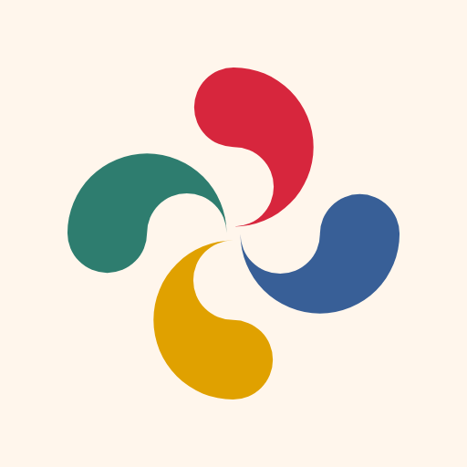
</p>

<h1 align="center">Hitz</h1>

<p align="center">
  <b>Learn Basque (euskara batua) from Spanish, from zero to A1 and on into A2.</b><br>
  Short lessons, real Basque voices, no account and no ads. Works offline.
</p>

<p align="center">
  <a href="https://github.com/frrodrig/hitz/releases/latest"></a>
  <a href="https://github.com/frrodrig/hitz/actions/workflows/ci.yml"></a>
  
  <a href="LICENSE">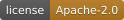</a>
</p>

<p align="center">
  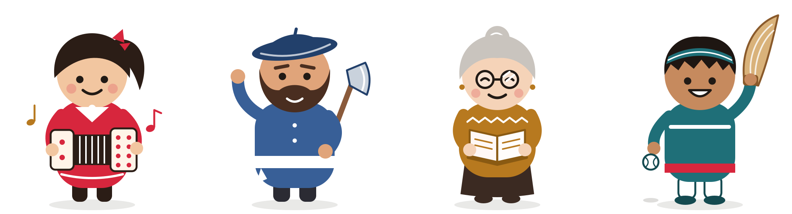
</p>

*Hitz* means "word" in Basque. Four Basque friends take you through the course: **Ane** the
trikitilari, **Mikel** the aizkolari, **Maite** the amona and **Unai** the pelotari.

## Screenshots

<p align="center">
  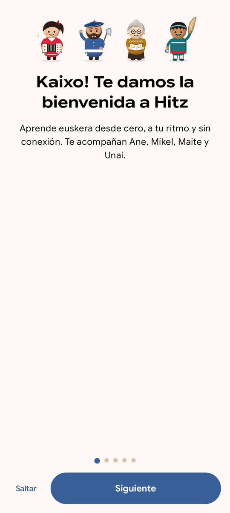
  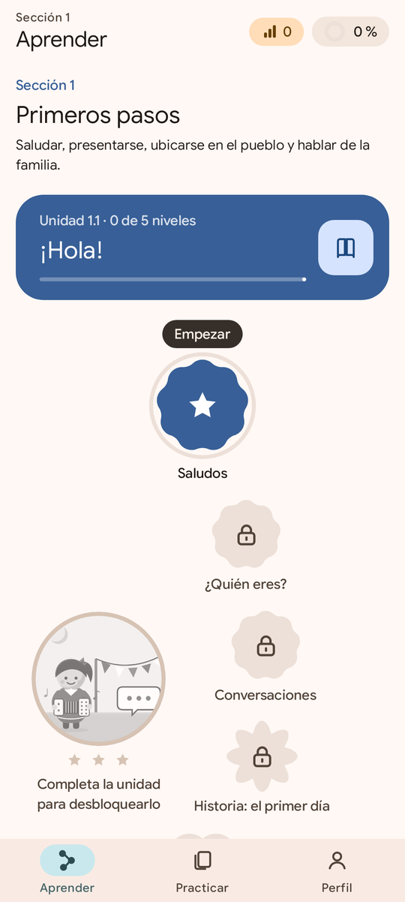
  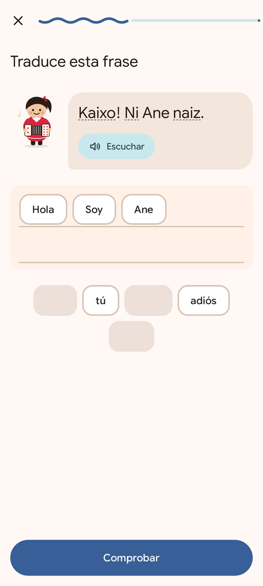
  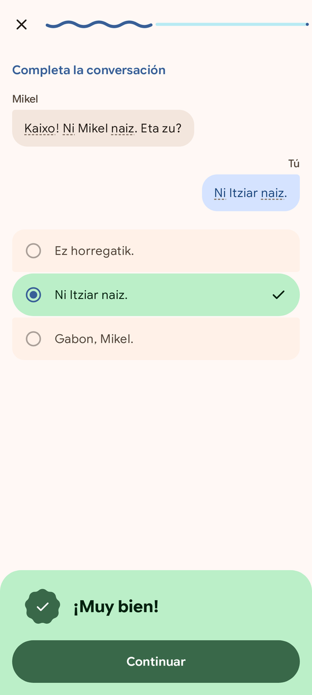
</p>
<p align="center">
  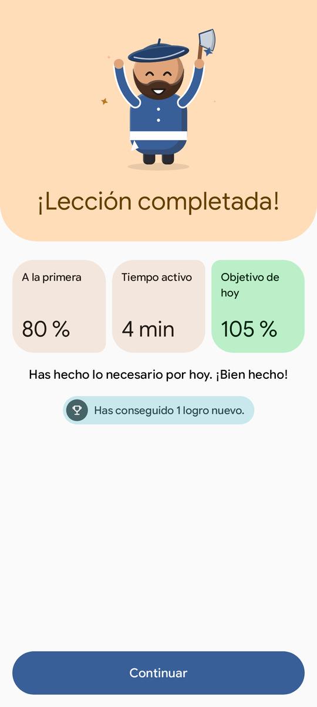
  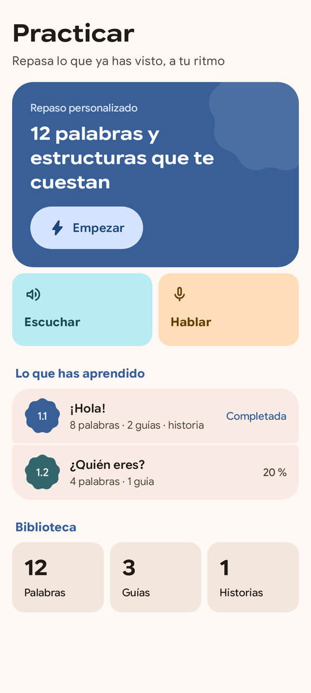
  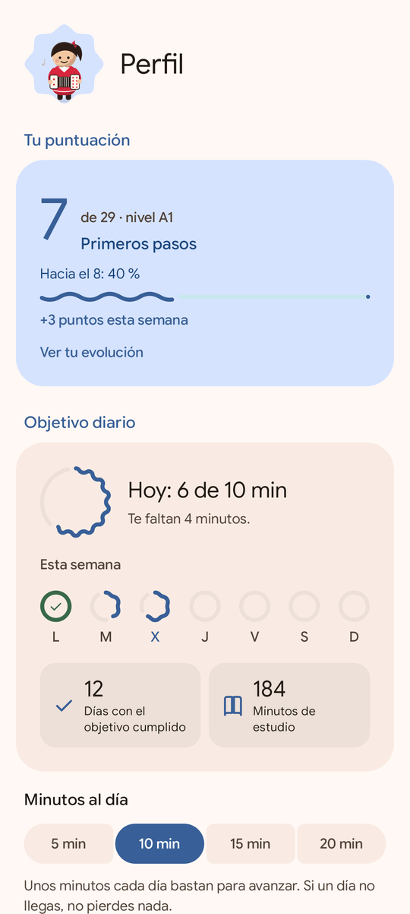
  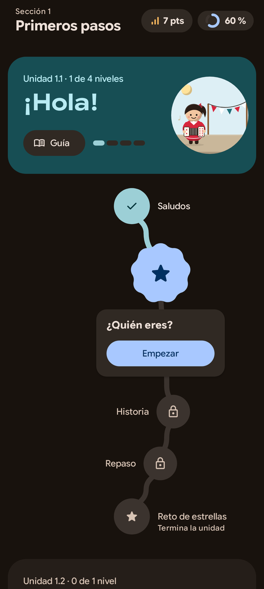
</p>
<p align="center">
  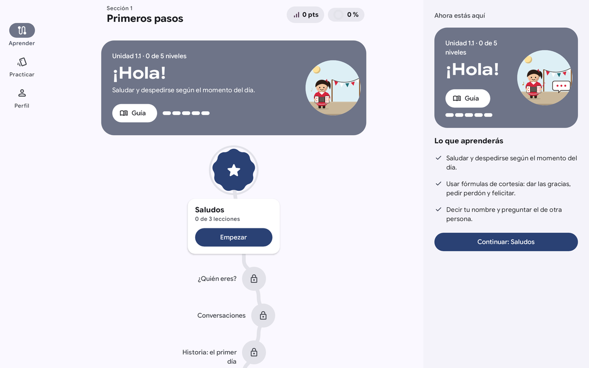
</p>

## What's inside

- **A full A1 course and the start of A2**: 5 sections, 30 units, 270 lessons, a story per unit
  and about 750 words, in the curricular order of the *Arian A1* and *Arian A2.1* textbooks (see
  [`docs/syllabus.md`](docs/syllabus.md)). The A2 part grows section by section. All texts,
  dialogues, exercises and illustrations are original.
- **13 kinds of exercise**: translate with a word bank or by typing, choose the picture or the
  meaning, match pairs, listen and tap, listen and type, fill the gap, complete a chat, read and
  answer true or false, order the sentence, speak (optional) and "new word" cards. Answers are
  checked tolerantly (capitals, accents, punctuation, small typos).
- **Made for learning alone**: a first-run introduction, an introduction and a guide for every
  unit, tap hints on every Basque word, and a placement test for those who already know some
  Basque.
- **Real Basque pronunciation**: every sentence of the course is bundled as audio, with the
  Basque voices of HiTZ – Aholab (EHU); playable slowly too.
- **One section at a time**: the path shows the current section, with a sections overview
  (level, goals, progress) and a test to jump ahead; after every textbook unit, an optional
  review mixes earlier units, chosen by your mistakes and by how long ago you saw them.
- **Practice**: a personal review of the words and structures you get wrong (spaced repetition),
  listening and speaking practice, and a review of every unit you have started.
- **Motivation without pressure**: a daily goal in minutes, achievements, a score on the CEFR
  scale (A1 0–29, A2 30–59) and a star challenge in every unit: 30 hard questions, one to three stars. No
  lives, no streaks to lose, no ads, no account.
- **Built with care**: Material 3 Expressive, the system's colours (Material You) or Hitz's own,
  light and dark themes, TalkBack, large fonts and tablets (with the current unit beside the
  path); interface in Spanish and Basque.
- **Private**: everything stays on the phone. The only network request is a daily check for a new
  version, which can be turned off.

## Install

Download `hitz-<version>.apk` from the [latest release](https://github.com/frrodrig/hitz/releases/latest)
and open it on an Android 8.0+ phone (allow installing from that source when asked). Once
installed, the app tells you when a new version is out and downloads it for you.

## Development

Kotlin and Jetpack Compose (Material 3 Expressive), Clean Architecture with Hilt, Room, DataStore,
type-safe Navigation and WorkManager. Course content is JSON validated by a schema; CI/CD runs on
GitHub Actions. Requirements: JDK 17 and the Android SDK (API 37.1).

```bash
./gradlew assembleDebug           # debug APK
./gradlew detekt                  # style (detekt + ktlint rules)
./gradlew lintDebug               # Android Lint
./gradlew testDebugUnitTest       # unit and screenshot tests
pip install -r tools/requirements.txt
python3 tools/validate_content.py # validate the course content
```

Every PR gets a debug APK as an artifact of its **CI** run.

| Document | What it covers |
|---|---|
| [`docs/architecture.md`](docs/architecture.md) | Modules, layers, the lesson engine, progress, audio, updates, build and CI/CD |
| [`docs/design-system.md`](docs/design-system.md) | Theme, cast, icons and components |
| [`docs/content-guide.md`](docs/content-guide.md) | How course content and audio are written, validated and generated |
| [`docs/syllabus.md`](docs/syllabus.md) | Units, goals, grammar and vocabulary |
| [`docs/design/`](docs/design/README.md) | Design work: the Material 3 Expressive redesign boards |
| [`CONTRIBUTING.md`](CONTRIBUTING.md) | Branches, commits, screenshots, audio and releases |
| [`AGENTS.md`](AGENTS.md) | Guide for AI coding agents working on the repository |

## License and credits

[Apache License 2.0](LICENSE), for both code and course content.

The Basque voices (Maider and Antton) are by the **HiTZ Basque Center for Language Technology –
Aholab Signal Processing Laboratory, University of the Basque Country (EHU)**, developed with
funding from Project ILENIA (models Apache-2.0, voice data
[CC BY 4.0](https://creativecommons.org/licenses/by/4.0/)), in the Piper versions published by
[itzune](https://huggingface.co/itzune). The course audio is synthesised with them by
`tools/audio/cast_voices.py`.
