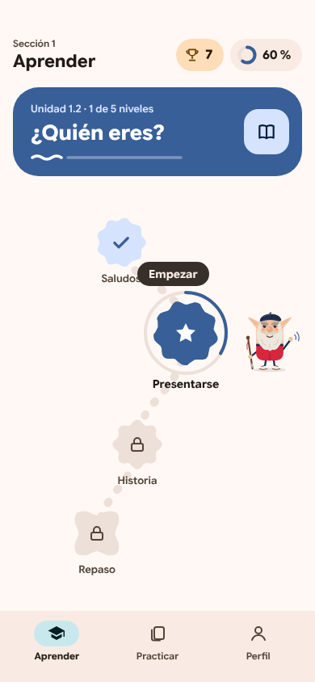
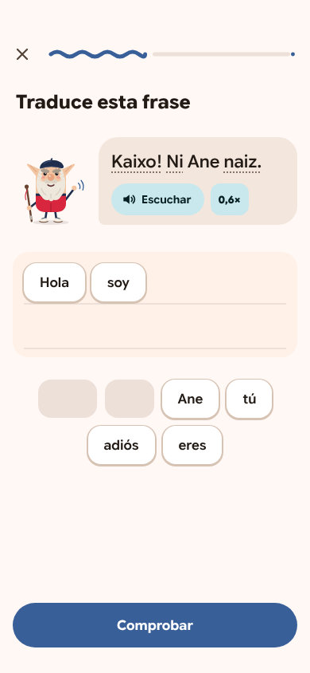
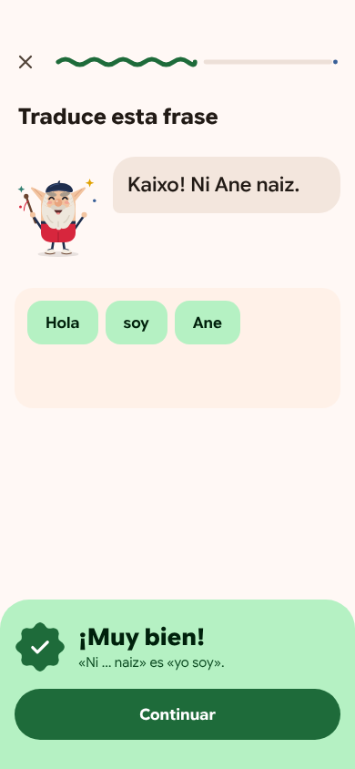
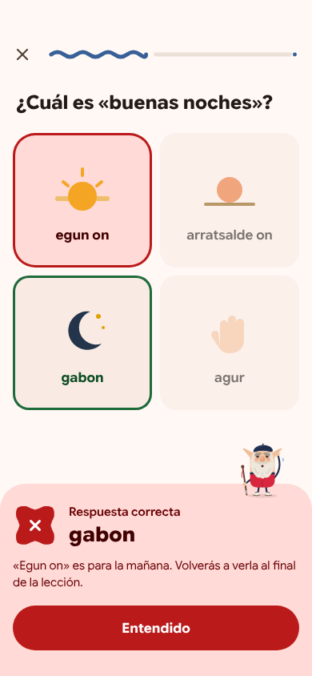
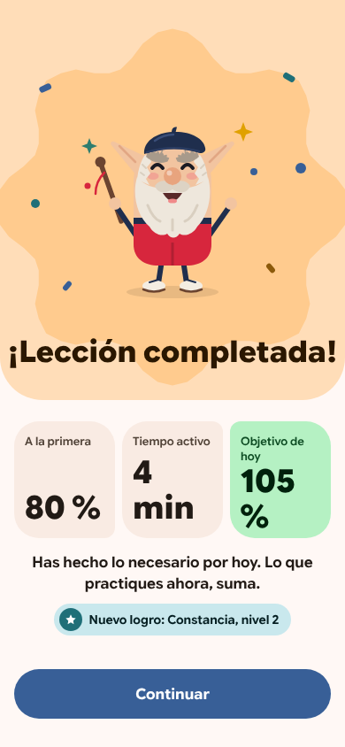
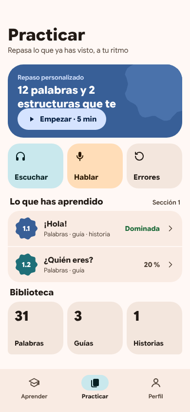
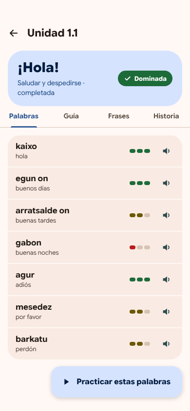
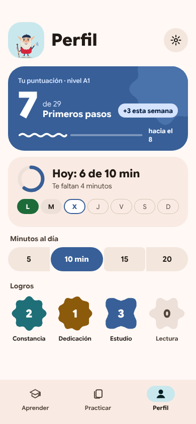

# Design work

Design material made before implementing changes, kept here as the record of why the app looks
the way it does. The source of truth for the current design is
[`docs/design-system.md`](../design-system.md) and the code in `:core:designsystem`; these boards
are not updated after the fact.

| Where | What |
|---|---|
| [`redesign-b.md`](redesign-b.md) | Redesign B, "each unit, a place" (late November 2026): principles, screens and delivery plan |
| [`m3-expressive/`](m3-expressive/) | The Material 3 Expressive redesign (November 2026), below |
| [`../../tools/design/art/cast/`](../../tools/design/art/cast/) | The cast: 16 SVGs (4 members × 4 poses), the source of the in-app vectors and animations |
| [`../../tools/design/illustrations/`](../../tools/design/illustrations/) | Exercise pictures, drawn as code |
| [`../../tools/design/generate_color_scheme.py`](../../tools/design/generate_color_scheme.py) | The colour scheme, generated from the brand seeds with Material Color Utilities |
| [`../store/icon-512.png`](../store/icon-512.png) | The app icon at Google Play size |

## Material 3 Expressive redesign (November 2026)

A review of the app against the M3 and M3 Expressive guidelines (m3.material.io), with the
proposal that was then implemented in PRs #43–#53. The boards are in Spanish, like the app. They
still show the **Galtzagorri**, the single mascot that the cast of four replaced in #63.

### Diagnosis, visual system and identity

| Board | Decision |
|---|---|
| [Diagnosis](m3-expressive/01-diagnosis.png) | Each screen checked against the guidelines: navigation, components, colour, shape and motion |
| [Visual system](m3-expressive/02-visual-system.png) | Colour roles, result families, colour per unit, Google Sans Flex type scale, shapes with a stable meaning, expressive motion tokens and M3 components per screen |
| [Primary colour](m3-expressive/03-primary-colour.png) | Primary moved from red to *itsaso* blue `#385F97`: red stays for errors and the illustration, so it always means "wrong" |
| [App icon](m3-expressive/04-app-icon.png) | Three proposals; the **lauburu** (C) was chosen: four arms in red, blue, ochre and sea green, one per cast member |

### Screens

  
  
  
  

  
  
  
  

- **Path**: top bar with the section, score and daily goal; sticky unit header coloured per unit;
  a larger current node whose expressive shape turns slowly.
- **Lesson**: the prompt said by a cast member in a speech bubble, 48 dp word tiles, a ruled
  answer tray; feedback coloured by result family.
- **Lesson finished**: a hero on the tertiary container and three result tiles.
- **Practice** (new destination): personal review, quick listening and speaking practice, the
  units learned so far and a review of each (words with strength and audio, guide, phrases,
  story).
- **Profile**: the score as hero, tonal containers and a connected button group for the daily
  goal.

The boards were made on a design canvas outside the repository and exported here as PNG.
